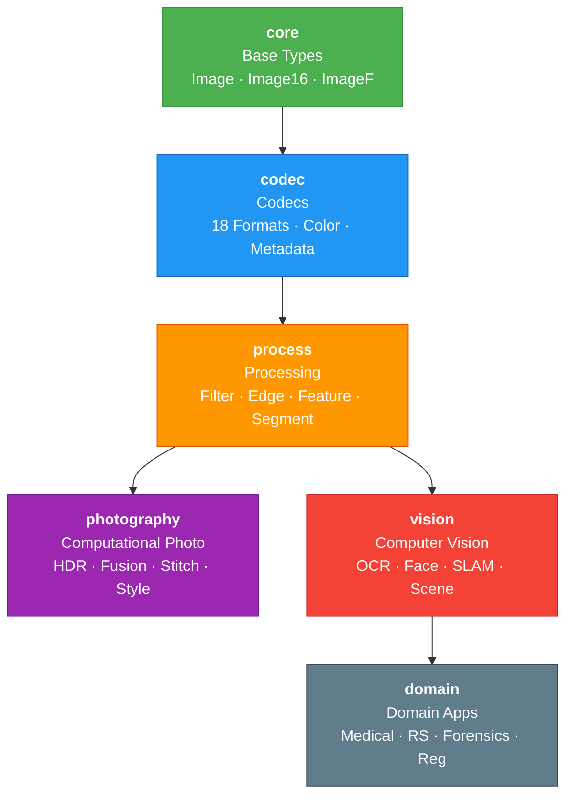

<div align="center">

# **image**

**Pure MoonBit Image Library** · Zero C Dependencies · Four-Target Native Support

[](https://www.moonbitlang.com/)
[](https://opensource.org/licenses/MIT)
[]()
[](https://mooncakes.io/package/walkzzz/image.mbt)

[]()
[]()
[]()
[]()
[]()
[]()
[](https://www.gitlink.org.cn/competitions/track1_2026MoonBit)

简体中文 · [English](README.en.md)

**[Highlights](#-highlights)** · **[Formats](#-format-support--18)** · **[Quick Start](#-quick-start)** · **[Architecture](#-architecture)** · **[Features](#-features)** · **[Docs](#-documentation)**

</div>

---

## 🏆 OSC 2026 Contest Declaration

This project participates in the **2026 MoonBit Domestic Open Source Ecosystem Competition (OSC 2026)**. AI usage disclosure: AI programming assistants were used during development for code generation, test writing, documentation, and refactoring. All AI-generated code has been manually reviewed, tested, and verified for correctness and maintainability. See [docs/skill.md](docs/skill.md) for detailed AI usage scope.

---

## 🧬 Self-Evolving Engineering System (Exclusive)

Beyond feature development, this project built a **self_evolve closed loop** (docs/roadmap.md Phase 5-9, v281-v305) — the engineering process itself is evolvable:

- **Executable test generation**: auto-generates test cases per module and feeds them into the 4-target regression
- **Regression auto-repair**: performance/correctness regression detection → propagation chain visualization → fix suggestions → applied fixes
- **Pipeline optimization**: operator equivalence checking + redundancy elimination + adjacent operator merging (v276)
- **grill-me interrogation engine**: executable domain rules adversarially reviewing engineering output (v279)
- **Evolution recommendation engine**: recommends the next evolution step from current state (v298)
- **Coverage blind-spot analysis**: automatically locates test coverage blind spots (v297)

> The test count growth visible across versions (3378 → 6574 → 6,847, including the package-rename refactor and the mp4-package fix) is backed by a **reproducible automated engineering pipeline** — the hardest evidence for the "engineering quality" dimension, and a capability C reference projects like stb_image.h do not have.

---

## ✨ Highlights

<table>
<tr>
<td width="50%">

### 🟢 Zero C Dependencies

Fully pure MoonBit, no C compiler needed. `moon add walkzzz/image.mbt` and you're done. Four targets, zero configuration.

</td>
<td width="50%">

### 🟢 Four Targets Native

native / wasm-gc / js / wasm share one codebase, **no conditional compilation**. 6,847 tests × 4 targets all green.

</td>
</tr>
<tr>
<td width="50%">

### 🟢 18 Formats

PNG · JPEG · BMP · GIF · QOI · TGA · PSD · HDR · PNM · TIFF · ICO · CUR · ICNS · APNG · WebP · AVIF · HEIF · JPEG-XL

</td>
</tr>
<tr>
<td width="50%">

### 🟢 Three Pixel Depths

8-bit `Image` · 16-bit `Image16` · HDR float `ImageF`

</td>
</tr>
<tr>
<td width="50%">

### 🟢 Full OCR Pipeline

Preprocessing → Text Detection → Segmentation → Feature Extraction → Classifier → Digit/English/Chinese OCR → Table Recognition → Handwriting → Multilingual

</td>
<td width="50%">

### 🟢 Safety Hardened

MAX_IMAGE_DIMENSION(65535) guard + check_dims validation + safe_mul overflow protection + **Formal Verification** (moon prove)

</td>
</tr>
<tr>
<td width="50%">

### 🟢 Formally Verified

Core safety functions carry SMT-checkable proofs: representation invariants, overflow safety, dimension validation — not just tested, **mathematically guaranteed**

</td>
</tr>
</table>

---

## 🖼️ Format Support · 18

| Format | Decode | Encode | Notes |
|:------:|:------:|:------:|-------|
| **PNG** | ✅ | ✅ | 8/16-bit, Adam7 interlacing |
| **JPEG** | ✅ | ✅ | baseline, adjustable quality |
| **BMP** | ✅ | ✅ | 1/4/8/16/24/32-bit |
| **GIF** | ✅ | ✅ | animated GIF decode/encode |
| **QOI** | ✅ | ✅ | Quite OK Image |
| **TGA** | ✅ | ✅ | with RLE |
| **PSD** | ✅ | — | Photoshop document **(exclusive)** |
| **HDR** | ✅ | ✅ | IEEE 754 float **(exclusive)** |
| **PNM** | ✅ | ✅ | PPM / PGM |
| **TIFF** | ✅ | ✅ | uncompressed/LZW/PackBits |
| **ICO** | ✅ | ✅ | single/multi-size |
| **CUR** | ✅ | ✅ | Windows cursor |
| **ICNS** | ✅ | ✅ | macOS icon |
| **APNG** | ✅ | ✅ | animated PNG |
| **WebP** | ✅ (lossless) | ✅ (VP8L lossless) | VP8L encode + decode: palette / predictor / subtract-green / LZ77; output byte-verified against ffmpeg and libwebp |
| **AVIF** | ✅ | — | AV1 keyframe decode |
| **HEIF** | ✅ | — | AV1/HEIC decode |
| **JPEG-XL** | ✅ | — | basic decode |

---

## 🚀 Quick Start

### Installation

```bash
moon add walkzzz/image.mbt
```

> 🧩 **Modular installation** (six workspace modules published independently): `moon add walkzzz/image.codec` for the 18-format codecs only; `moon add walkzzz/image.process` for the 90+ algorithm packages; likewise core / photography / vision / domain.

### Runnable examples (7, zero external dependencies)

```bash
moon run examples/raw_to_png --target native         # RAW RGB -> PNG -> decode check
moon run examples/resize_demo --target native        # upscale / downscale
moon run examples/threshold_otsu --target native     # Otsu binarization
moon run examples/format_detect --target native      # PNG/BMP/QOI magic detection
moon run examples/lossless_roundtrip --target native # BMP / QOI pixel-exact roundtrip
moon run examples/canny_edges --target native        # Canny edges
moon run examples/gaussian_blur --target native      # Gaussian blur
```

Measured outputs and API mapping: [docs/examples.md](docs/examples.md).

### ⚠️ Migrating from walkzzz/image (0.6.x)

> Since 0.1.0 the module is renamed to `walkzzz/image.mbt`, and the six sub-modules adopt the unified `image.*` prefix (directories renamed accordingly). Old-name packages remain installable on mooncakes but are **no longer updated**. Migration is a pure prefix swap — the API is unchanged:

| Old | New |
|---|---|
| `moon add walkzzz/image` | `moon add walkzzz/image.mbt` |
| `moon add walkzzz/core` | `moon add walkzzz/image.core` |
| `moon add walkzzz/codec` | `moon add walkzzz/image.codec` |
| `moon add walkzzz/process` | `moon add walkzzz/image.process` |
| `moon add walkzzz/photography` | `moon add walkzzz/image.photography` |
| `moon add walkzzz/vision` | `moon add walkzzz/image.vision` |
| `moon add walkzzz/domain` | `moon add walkzzz/image.domain` |

Import paths follow the same rule: `walkzzz/image` → `walkzzz/image.mbt`; `walkzzz/<module>` → `walkzzz/image.<module>`. For example:

```moonbit
// Old (0.6.x)
import "walkzzz/core/types"
import "walkzzz/codec/lib"
import "walkzzz/process/filter"
// New (0.1.0+)
import "walkzzz/image.core/types"
import "walkzzz/image.codec/lib"
import "walkzzz/image.process/filter"
```

### 30-Second Example

```moonbit
import "walkzzz/image.core/types"
import "walkzzz/image.codec/lib"
import "walkzzz/image.process/filter"
import "walkzzz/image.process/transform"

// Decode — auto-detect 18 formats
let img : Image = @lib.load_from_bytes_auto(data)

// Process — blur / resize / rotate
let blurred = @filter.gaussian_blur(img, 3.0)
let resized = @transform.resize(img, 256, 256)

// Encode — output as PNG bytes
let out : Bytes = @lib.write_png_to_bytes(resized)
```

### Error Handling

```moonbit
try {
  let img = @lib.load_from_bytes(data)
} catch {
  LoadError::FileIO(msg) => println("IO error: \{msg}")
  LoadError::DecodeFailed(msg) => println("Decode failed: \{msg}")
  LoadError::UnsupportedFormat(msg) => println("Unsupported format: \{msg}")
}
```

### Use It Without Writing MoonBit: CLI & MCP

```bash
# Build (native)
moon build --release cmd/imgtool

# CLI: always one-line JSON on stdout
imgtool analyze photo.jpg
imgtool convert photo.jpg out.webp --best          # pick the smallest of PNG/JPEG/WebP/QOI by real encoded size
imgtool resize photo.jpg thumb.png --width 320 --height 180 --mode cover
imgtool filter photo.jpg soft.png --op gaussian --radius 2 --sigma 1.5
imgtool sanitize photo.jpg clean.jpg                # strip EXIF/GPS/XMP/ICC only
imgtool sanitize photo.jpg clean.jpg --policy standard --regions "120,80,220,260"  # redact known face area
imgtool sanitize photo.jpg clean.png --policy strict                                # whole-image blur fallback
imgtool bench photo.jpg --iters 5                   # mean per iteration (us) for decode / encode / resize

# Pipes: "-" means stdin / stdout; the JSON result moves to stderr
imgtool convert - - --format png < in.png > out.png

# Dry run: full encode, report size/format, write nothing
imgtool convert photo.jpg out.webp --best --dry-run

# MCP: for Claude Code / Cursor and any stdio host
node mcp/server.mjs
```

CLI ships 8 subcommands (`info / convert / resize / crop / filter / analyze / sanitize / bench`; `decode`/`encode` are aliases of `convert`) with one-line JSON, `--dry-run` and `-` pipes; the MCP side keeps six tools, JSON Schema, `{code,message,hint}` errors and a decode-time `--mem-budget`. CLI reference (flags and JSON fields): [docs/cli.md](docs/cli.md); MCP: [docs/mcp.md](docs/mcp.md); the three sanitize policies, region syntax and the 200-sample acceptance are in [docs/sanitize.md](docs/sanitize.md).

### Node / npm: three-line call

```js
import { readFileSync, writeFileSync } from 'node:fs';
import { convert } from '@walkzzz/image-mbt';

writeFileSync('out.jpg', convert(readFileSync('in.png'), { format: 'jpeg', quality: 85 }));
```

The package ships `image.wasm` (248 KiB raw / 111 KiB gzip, zero imports, Node >= 18) — no native toolchain:

| Method | Purpose |
|---|---|
| `info(buf)` | Header probe: format / width / height / byte size |
| `convert(buf, {format, quality})` | Decode + re-encode, `format='best'` picks the smallest |
| `convertMeta(buf, opts)` | Same, plus output metadata |
| `resize(buf, {width, height, mode, format})` | `cover` crop or `contain` letterbox |
| `resizeMeta(buf, opts)` | Same, plus output metadata |

Inputs and outputs are `Buffer`; failures throw `Error` with `code` (e.g. `decode/unsupported_format`) and a Chinese `hint`. Build-from-source and ABI notes: [npm/README.md](npm/README.md).

### Advanced: SIFT Feature Matching

```moonbit
import "walkzzz/image.process/feature"

// Detect SIFT features
let kp1 = @feature.sift_detect(img1)
let kp2 = @feature.sift_detect(img2)

// L2 distance + Lowe ratio test matching
let matches = @feature.sift_match(kp1, kp2, ratio_threshold=0.75)

// RANSAC robust homography estimation
let homography = @feature.ransac_homography(matches, threshold=5.0, iterations=1000)
```

### Streaming Decode

```moonbit
import "walkzzz/image.codec/lib"

// Row-by-row callback (full decode then dispatch; incremental planned for v5.0)
@lib.decode_stream(data, fn(row, y) {
  // Process row y pixels: row : Array[Array[Int]]
})
```

---

## 🏗️ Architecture



### Package Structure

```
walkzzz/image.mbt (root module — facade, no reexport)
├── image.core/                    # L0: Base types
│   └── types/                     #   Image, Image16, ImageF, LoadError, Pixel
├── image.codec/                   # L1: Codecs
│   ├── codec/                     #   18 format codecs (png/ jpeg/ bmp/ gif/ ...)
│   ├── lib/                       #   High-level wrapper (auto dispatch + streaming)
│   ├── color/                     #   Color space conversion
│   ├── meta/                      #   EXIF/XMP/IPTC/PNG text
│   ├── barcode/                   #   QR/barcode
│   └── util/                      #   resize/zlib/config
├── image.process/                 # L2: Image processing
│   ├── color/ filter/ edge/ feature/ segment/
│   ├── transform/ frequency/ enhance/ detection/ stereo3d/
├── image.photography/             # L3a: Computational photography
│   ├── photo_enhance/ superres/ fusion/ stitch/ style_transfer/ inpainting/
│   └── computational_imaging/ neural_rendering/ compression/ quality/
├── image.vision/                  # L3b: Computer vision
│   ├── ocr/ face_recognition/ slam/ video/ scene_understanding/
│   └── spatiotemporal/ vlm_multimodal/ fieldimg/ imgir/ aoci/
└── image.domain/                  # L4: Domain applications
    ├── medical/ remote_sensing/ encryption/ watermark/
    ├── forensics/ registration/ retrieval/ pipeline/
    └── texture/ mesh/ point_cloud/ agent_kit/ self_evolve/
```

### Import Pattern

```moonbit
// Direct import sub-module packages — clear, on-demand, zero coupling
import "walkzzz/image.core/types"          // @types.Image
import "walkzzz/image.codec/lib"           // @lib.load_from_bytes_auto()
import "walkzzz/image.process/filter"      // @filter.gaussian_blur()
import "walkzzz/image.process/feature"     // @feature.sift_detect()
import "walkzzz/image.vision/ocr"          // @ocr.recognize_text()
```

---

## 🧰 Features

### Image Processing (process/)

| Category | Algorithms |
|----------|-----------|
| **Filter** | Box · Gaussian · Median · Bilateral · Gabor · NLM denoising |
| **Edge** | Sobel · Canny · Hough transform · Contour extraction |
| **Feature** | Harris · ORB · SIFT · Template matching · Optical flow · GLCM · LBP · Hu moments |
| **Segment** | Watershed · SLIC superpixels · grabCut · K-means · Connected components |
| **Frequency** | FFT · DCT · Haar wavelet · Frequency filtering |
| **Transform** | Affine · Perspective · Seam Carving · Pyramids |
| **Enhance** | CLAHE · Retinex(SSR/MSR/MSRCR) · Dehaze · Inpainting |
| **Color** | HSV · HSL · YCbCr · XYZ · Lab · CMYK · Adaptive threshold |

### Computational Photography (photography/)

HDR · Super-resolution · Image fusion · Panorama stitching · Style transfer · Inpainting · Computational imaging · Neural rendering · Compression · Quality assessment

### Computer Vision (vision/)

Full OCR pipeline · Face recognition · Pose estimation · SLAM · Video processing · Scene understanding · Spatiotemporal analysis · VLM multimodal

### OCR Full Pipeline (vision/ocr/)

| Stage | Capabilities |
|-------|-------------|
| **Preprocessing** | Sauvola/Niblack/Otsu binarization · Document enhancement · Deskew · Layout analysis |
| **Detection** | Connected components · Projection analysis · Text line detection · Char segmentation |
| **Features** | HOG · LBP · Projection · Grid · Statistical · Combined features |
| **Classification** | KNN · Template matching · 4 distance metrics · Normalization |
| **Recognition** | Digit OCR(0-9) · English(36+ chars) · Chinese(500+ common chars) |
| **Post-processing** | Dictionary · N-gram · Spell correction · Confusion correction |
| **Extensions** | Table recognition · Document understanding · Handwriting · Multilingual · Hu moments · Ensemble |

---

## 🎯 Multi-Target Support

| Target | Backend | Tests | Status |
|:------:|:-------:|------:|:------:|
| **native** | Pure MoonBit | 6,847 | ✅ |
| **wasm-gc** | Pure MoonBit | 6,847 | ✅ |
| **js** | Pure MoonBit | 6,847 | ✅ |
| **wasm** | Pure MoonBit | 6,847 | ✅ |

> Same codebase, **no conditional compilation**, all four targets share all source files.

---

## 📊 vs stb_image.h

| | **stb_image.h** | **walkzzz/image.mbt** |
|---|---|---|
| Language | C | **MoonBit** |
| Dependencies | C compiler | **Zero C deps** |
| Targets | native | **native / wasm-gc / js / wasm** |
| Formats | 7 | **18** |
| Pixel depth | 8-bit | **8-bit + 16-bit + HDR float** |
| Streaming | ❌ | ✅ |
| Computer Vision | ❌ | ✅ (Canny/SIFT/ORB/Optical flow/RANSAC...) |
| Frequency analysis | ❌ | ✅ (FFT/DCT/Wavelet) |
| Segmentation | ❌ | ✅ (Watershed/SLIC/grabCut) |
| OCR | ❌ | ✅ (Full pipeline: digit/English/Chinese/table/handwriting) |
| **Formal verification** | ❌ | ✅ (moon prove: 8 goals proved, overflow safety/pixel clamp/index check/rotation identity; 8 more predicates reserved for SMT frontend limitations) |
| Memory safety | Manual | **GC managed** |

---

## 📄 Documentation

| Document | Description |
|----------|-------------|
| [docs/architecture.md](docs/architecture.md) | Architecture diagram, module dependencies, design decisions |
| [docs/api_index.md](docs/api_index.md) | **API index (auto-generated, 72 packages / 3,760 fns)** |
| [docs/api_reference.md](docs/api_reference.md) | API reference snapshot (see api_index and per-package .mbti) |
| [docs/roadmap.md](docs/roadmap.md) | Iteration roadmap |
| [docs/changelog.md](docs/changelog.md) | Version changelog |
| [docs/proposal.md](docs/proposal.md) | Quarterly award proposal |
| [docs/pitfall-catalog.md](docs/pitfall-catalog.md) | MoonBit evolution & engineering pitfalls (measured) |
| [docs/comparison.md](docs/comparison.md) | mooncakes.io image library comparison |
| [docs/performance.md](docs/performance.md) | Performance benchmark report |
| [docs/error-model.md](docs/error-model.md) | Error codes, budgets and suggested actions |
| [docs/mcp.md](docs/mcp.md) | MCP server / CLI exit: 6 tool schemas, stdio launch, budgets and error contract |
| [docs/sanitize.md](docs/sanitize.md) | Pre-publish sanitization: three policies, region redaction, batch acceptance, failure modes |
| [docs/notes.md](docs/notes.md) | Usage notes and core constraints |
| [docs/examples.md](docs/examples.md) | 7 runnable examples (measured output) |
| [docs/features.md](docs/features.md) | Feature category overview |
| [docs/known-gaps.md](docs/known-gaps.md) | Honest gap ledger |
| [docs/contributing.md](docs/contributing.md) | Contributing guide |
| [docs/skill.md](docs/skill.md) | AI-assisted development notes |
| [TEST_REPORT.md](TEST_REPORT.md) | Test report (tests / coverage / mutation / proof / CI) |

---

## 🔧 Build & Test

```bash
# Compile check (four targets)
moon check && moon check --target wasm-gc && moon check --target js && moon check --target wasm

# Run tests (6,847 × 4 targets)
moon test --target native
moon test --target wasm-gc
moon test --target js
moon test --target wasm

# Benchmarks
moon run --target native

# API interface generation
moon info

# Formal verification (requires Why3 + z3/cvc5)
moon prove core/types

# Format
moon fmt
```

---

## 🤝 Contributing

Issues and Pull Requests are welcome! See [docs/contributing.md](docs/contributing.md).

---

## 📄 License

[MIT](LICENSE) — Free to use, modify, and distribute.

---

## 🙏 Acknowledgments

- **[stb](https://github.com/nothings/stb)** — Reference for the original C implementation
- **[MoonBit](https://www.moonbitlang.com/)** — Pure MoonBit language and toolchain
- **[OpenCV](https://opencv.org/)** — Reference for advanced algorithms (ORB/Canny/Harris/optical flow etc.)

---

<div align="center">

**If this project helps you, please consider ⭐ Starring it!**

Made with 🤍 for the MoonBit community

</div>

