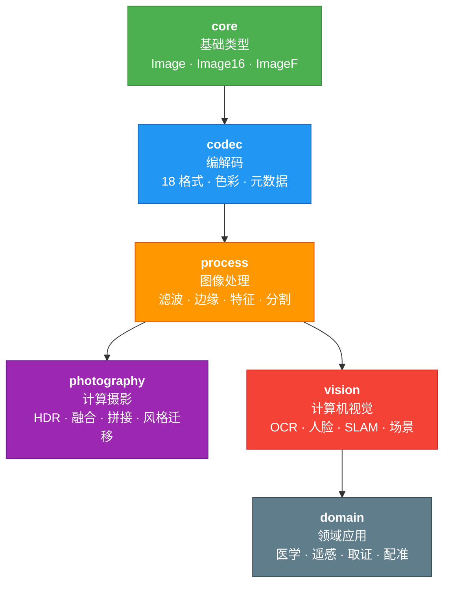

<div align="center">

# **image**

**纯 MoonBit 图像处理库** · 零 C 依赖 · 四目标原生支持

[](https://www.moonbitlang.com/)
[](https://opensource.org/licenses/MIT)
[]()
[](https://mooncakes.io/package/walkzzz/image.mbt)

[]()
[]()
[]()
[]()
[]()
[]()
[](https://www.gitlink.org.cn/competitions/track1_2026MoonBit)

[English](README.en.md) · 简体中文

**[亮点](#-亮点)** · **[格式](#-格式支持-18-种)** · **[快速上手](#-快速上手)** · **[架构](#-架构)** · **[功能](#-功能一览)** · **[文档](#-文档)**

**在线演示**：迁移中（旧地址暂不可访问）。本地可跑 `examples/` 下 7 个示例，全部在浏览器内计算。

</div>

---

## 🏆 OSC 2026 参赛声明

本项目参与 **2026 MoonBit 国产基础软件开源大赛（OSC 2026）**。AI 辅助说明：本项目在开发过程中使用了 AI 编程助手辅助完成代码生成、测试编写、文档撰写和重构工作。所有 AI 生成代码均经过人工审查、测试验证和逻辑确认，确保代码质量、正确性和可维护性。详细 AI 使用范围见 [docs/skill.md](docs/skill.md)。

---

## 🧬 自演化工程体系（独家）

本项目构建了 **self_evolve 自演化闭环**（docs/roadmap.md Phase 5-9，v281-v305）——功能开发之外，工程过程本身也是可演化的：

- **可执行测试生成**：按模块特征自动生成测试用例并接入四目标回归
- **退化自动修复**：性能/正确性退化检测 → 传播链可视化 → 修复建议 → 应用闭环
- **管道优化**：算子等价性检查 + 冗余消除 + 相邻算子合并（v276）
- **grill-me 拷问引擎**：领域规则可执行化，对工程产出做对抗性审查（v279）
- **演化推荐引擎**：根据当前状态推荐下一步演化方向（v298）
- **覆盖盲区分析**：自动定位测试覆盖盲区（v297）

> 意义：评审看到的每个版本测试数增长（3378 → 6574 → 6,836，含包重命名重构期与 mp4 包修复期）背后，有一条**可复现的自动化工程流水线**——这是"工程质量"维度最硬的证据，也是 stb_image.h 等 C 参照项目不具备的能力。

---

> 🌱 **生态采用**：已被 [moonrockz/diagrams-raster](https://mooncakes.io/package/moonrockz/diagrams-raster) 依赖

> 🧰 **同作者生态**：[walkzzz/moon2dart](https://mooncakes.io/docs/walkzzz/moon2dart)（MoonBit → Dart/Flutter transpiler，MCP 服务器）+ [walkzzz/astrolabe](https://mooncakes.io/docs/walkzzz/astrolabe)（解析器组合子库，形式化验证 8 goals）——三库组成 **walkzzz MoonBit 工具集**

## ✨ 亮点

<table>
<tr>
<td width="50%">

### 🟢 零 C 依赖

全部纯 MoonBit 实现，无需 C 编译器。`moon add walkzzz/image.mbt` 即装即用，四目标零配置。

</td>
<td width="50%">

### 🟢 四目标原生

native / wasm-gc / js / wasm 共用同一代码库，**无条件编译**。6,836 测试 × 4 目标全绿。形式化验证 8 goals proved（另有 8 条预留谓词，SMT 超时与前端限制清单见 core/safe_math）。

</td>
</tr>
<tr>
<td width="50%">

### 🟢 18 种格式

PNG · JPEG · BMP · GIF · QOI · TGA · PSD · HDR · PNM · TIFF · ICO · CUR · ICNS · APNG · WebP · AVIF · HEIF · JPEG-XL

</td>
</tr>
<tr>
<td width="50%">

### 🟢 三种像素深度

8 位 `Image` · 16 位 `Image16` · HDR 浮点 `ImageF`

</td>
</tr>
<tr>
<td width="50%">

### 🟢 OCR 全链路

预处理 → 文本检测 → 字符分割 → 特征提取 → 分类器 → 数字/英文/中文 OCR → 表格识别 → 手写体 → 多语言混合

</td>
<td width="50%">

### 🟢 安全加固

MAX_IMAGE_DIMENSION(65535) 守卫 + check_dims 全入口校验 + safe_mul 溢出保护 + **形式化验证**（moon prove）

</td>
</tr>
<tr>
<td width="50%">

### 🟢 形式化验证

核心安全函数附带 SMT 可机检证明：表示不变量、溢出安全、维度校验——不只是测试通过，是**数学保证**

</td>
</tr>
<tr>
<td width="50%">

### 🟢 MoonBit 属性系统

`#derive(Eq, Default, @debug.Debug)` 自动实现 100+ 类型 · `#inline` 核心纯函数性能标注 · `#deprecated` API 迁移指引 · `#non_exhaustive` 53 个可扩展 enum 前向兼容

</td>
<td width="50%">

### 🟢 78 个子包

6 子模块 (core/codec/process/photography/vision/domain) · 用户直接 import 子包 · 根包仅门面

</td>
</tr>
</table>

---

## 🖼️ 格式支持 · 18 种

| 格式 | 解码 | 编码 | 备注 |
|:----:|:----:|:----:|------|
| **PNG** | ✅ | ✅ | 8/16-bit，Adam7 隔行扫描 |
| **JPEG** | ✅ | ✅ | baseline，可调质量 |
| **BMP** | ✅ | ✅ | 1/4/8/16/24/32-bit |
| **GIF** | ✅ | ✅ | 动画 GIF 解码/编码 |
| **QOI** | ✅ | ✅ | Quite OK Image |
| **TGA** | ✅ | ✅ | 含 RLE |
| **PSD** | ✅ | — | Photoshop 文档 **(独家)** |
| **HDR** | ✅ | ✅ | IEEE 754 浮点 **(独家)** |
| **PNM** | ✅ | ✅ | PPM / PGM |
| **TIFF** | ✅ | ✅ | 无压缩/LZW/PackBits |
| **ICO** | ✅ | ✅ | 单尺寸/多尺寸 |
| **CUR** | ✅ | ✅ | Windows 光标 |
| **ICNS** | ✅ | ✅ | macOS 图标 |
| **APNG** | ✅ | ✅ | 动画 PNG |
| **WebP** | ✅ (lossless) | ✅ (VP8L 无损) | VP8L 编解码：palette / predictor / subtract-green / LZ77；产物经 ffmpeg 与 libwebp 逐字节校验 |
| **AVIF** | ✅ | — | AV1 关键帧解码 |
| **HEIF** | ✅ | — | AV1/HEIC 解码 |
| **JPEG-XL** | ✅ | — | 基础解码 |

---

## 🚀 快速上手

### 安装

```bash
moon add walkzzz/image.mbt
```

然后一个 import 就能拿到高频 API：

```moonbit
import "walkzzz/image.mbt/all"
// @all.load_from_bytes_auto / @all.save_image_auto / @all.encode_webp_lossless
// @all.resize_to_cover / @all.crop / @all.rotate / @all.encode_png ...
```

> ✅ **一条 add 就够用**。`walkzzz/image.mbt/all` 是根模块里的门面包，把 types + 编解码 + 变换的高频 API 用 `pub using` 再导出，
> 所以不需要为这些 API 额外 add 任何子模块。

> ⚠️ **但 import 权限不跟着依赖传递**（MoonBit 规则：`moon.mod` 声明模块依赖、`moon.pkg` 声明包依赖，只有**直接依赖**的包才能 import）。
> 想直接写 `import "walkzzz/image.codec/lib"` / `"walkzzz/image.process/filter"` 这类**深层包**，那个子模块必须自己 add 一次，否则报
> `exists in global environment, but its containing module is not imported by <你的包>`：
>
> ```bash
> moon add walkzzz/image.codec@0.1.8    # 只是例子：要用 codec 的深层子包才需要
> ```

> 🧩 **子模块按需安装**（workspace 六模块独立发布）：`moon add walkzzz/image.codec` 只装 18 格式编解码；`moon add walkzzz/image.process` 只装 90+ 算法子包；core / photography / vision / domain 同理。

### 先跑通一条真实链路（`examples/quickstart`）

> 示例为了演示"子模块深挖"用的是 `@lib.load_from_bytes_auto` 这种显式包；如果你只想最快起步，用门面包 `@all` 的写法与它完全等价（见下方代码块第二段）。

```bash
moon run examples/quickstart --target native
```

输出（`moon run` 直接跑，不需要文件系统）：

```
sample  64x48 ch=3
webp    156 B
decode  64x48 ch=4 digest=3811942400
        WebP 无损往返像素一致（只比 RGB）
resize  32x24
png     158 B
verify  32x24 ch=4 ok=true
```

对应的库代码（与示例逐行一致，抄走就能用）：

```moonbit
import {
  "walkzzz/image.core/types",
  "walkzzz/image.codec/lib",
  "walkzzz/image.process/transform",
}

// 任何来源的字节都行：网络、文件、上游产物
let back = @lib.load_from_bytes_auto(bytes) catch { e => { println("坏图: \{e}"); return } }
// 编码：WebP 无损（体积小、逐像素可还原）；要给"人人能开"就出 PNG
let webp = @lib.encode_webp_lossless(back)
// 缩放：cover = 等比铺满后居中裁切；contain = 等比装入留白
let small = @transform.resize_to_cover(back, 320, 180)
```

只 add 了根模块时，等价写法（`@all` 门面包，不用 add 子模块）：

```moonbit
import "walkzzz/image.mbt/all"

let img = @all.load_from_bytes_auto(bytes)!
let small = @all.resize_to_cover(img, 320, 180)
let png = @all.encode_png(small)
```

大图只处理局部（ROI，零复制）：

```moonbit
// 取一块区域视图：只存坐标，不复制底图
let v = @all.region(img, 1200, 900, 1200, 900)
let px = @all.region_pixel(v, 10, 10)          // 坐标相对区域左上角
// 需要独立像素时才物化（唯一一次分配 = 区域大小）
let tile = @all.region_to_image(v)
// 或者按 Region 直接裁一刀：越界自动裁剪、不报错
let c = @all.crop_region(img, @all.Region::new(-50, -50, 200, 200))

// 大图出缩略图：只分配输出图（512*384*3 ≈ 576 KB），不建同量级中间缓冲
let thumb = @all.thumbnail(img, 512)
// 想先卡预算：输出超 512 MiB 直接拒绝（Budget/LimitBytes），不会先分配再报错
let guarded = @all.thumbnail_budgeted(img, 512, @all.alloc_budget_default())
```

### 可运行示例（8 个，零外部依赖）

```bash
moon run examples/quickstart --target native         # 5 分钟链路：WebP 无损往返 → 缩放 → PNG
moon run examples/raw_to_png --target native         # RAW RGB → PNG → 解码校验
moon run examples/resize_demo --target native        # 上采样 / 下采样
moon run examples/threshold_otsu --target native     # Otsu 二值化
moon run examples/format_detect --target native      # PNG/BMP/QOI 魔数探测
moon run examples/lossless_roundtrip --target native # BMP / QOI 像素级往返
moon run examples/canny_edges --target native        # Canny 边缘
moon run examples/gaussian_blur --target native      # 高斯模糊
```

实测输出与 API 对照见 [docs/examples.md](docs/examples.md)。

### ⚠️ 从 walkzzz/image（0.6.x）迁移

> 0.1.0 起模块重命名为 `walkzzz/image.mbt`，六子模块统一 `image.*` 前缀（目录同步改名）。旧名包在 mooncakes 上仍可安装但**不再更新**。迁移只需替换模块前缀，API 完全不变：

| 旧 | 新 |
|---|---|
| `moon add walkzzz/image` | `moon add walkzzz/image.mbt` |
| `moon add walkzzz/core` | `moon add walkzzz/image.core` |
| `moon add walkzzz/codec` | `moon add walkzzz/image.codec` |
| `moon add walkzzz/process` | `moon add walkzzz/image.process` |
| `moon add walkzzz/photography` | `moon add walkzzz/image.photography` |
| `moon add walkzzz/vision` | `moon add walkzzz/image.vision` |
| `moon add walkzzz/domain` | `moon add walkzzz/image.domain` |

import 路径同步替换：`walkzzz/image` → `walkzzz/image.mbt`；`walkzzz/<子模块>` → `walkzzz/image.<子模块>`。例如：

```moonbit
// 旧（0.6.x）
import "walkzzz/core/types"
import "walkzzz/codec/lib"
import "walkzzz/process/filter"
// 新（0.1.0+）
import "walkzzz/image.core/types"
import "walkzzz/image.codec/lib"
import "walkzzz/image.process/filter"
```

### 30 秒示例

```moonbit
import "walkzzz/image.core/types"
import "walkzzz/image.codec/lib"
import "walkzzz/image.process/filter"
import "walkzzz/image.process/transform"

// 解码 — 自动检测 18 种格式
let img : Image = @lib.load_from_bytes_auto(data)

// 处理 — 滤波 / 缩放 / 旋转
let blurred = @filter.gaussian_blur(img, 3.0)
let resized = @transform.resize(img, 256, 256)

// 编码 — 输出为 PNG 字节
let out : Bytes = @lib.write_png_to_bytes(resized)
```

### 错误处理

```moonbit
try {
  let img = @lib.load_from_bytes(data)
} catch {
  LoadError::FileIO(msg) => println("IO 错误: \{msg}")
  LoadError::DecodeFailed(msg) => println("解码失败: \{msg}")
  LoadError::UnsupportedFormat(msg) => println("不支持的格式: \{msg}")
}
```

### 不写 MoonBit 也能用：CLI 与 MCP

```bash
# 构建（native）
moon build --release cmd/imgtool

# CLI：结果恒为单行 JSON，可直接 jq
imgtool analyze photo.jpg
# {"path":"photo.jpg","format":"jpeg","width":1920,"height":1080,"channels":3,"mean":[…],"ok":true}

imgtool convert photo.jpg out.webp --best          # 在 PNG/JPEG/WebP/QOI 里按实际编码体积选最小
imgtool resize photo.jpg thumb.png --width 320 --height 180 --mode cover
imgtool filter photo.jpg soft.png --op gaussian --radius 2 --sigma 1.5
imgtool sanitize photo.jpg clean.jpg                # 只剥 EXIF/GPS/XMP/ICC
imgtool sanitize photo.jpg clean.jpg --policy standard --regions "120,80,220,260"  # 打码已知人脸区
imgtool sanitize photo.jpg clean.png --policy strict                                # 整图模糊兜底
imgtool bench photo.jpg --iters 5                   # decode / encode / resize 每轮均值（微秒）

# 管道：路径写 - 即 stdin / stdout，JSON 结果改走 stderr
imgtool convert - - --format png < in.png > out.png

# 只算不写：完整编码后返回体积与格式，但不落盘
imgtool convert photo.jpg out.webp --best --dry-run

# MCP：给 Claude Code / Cursor 等 host 用
node mcp/server.mjs
```

CLI 8 个子命令（`info / convert / resize / crop / filter / analyze / sanitize / bench`，`decode`/`encode` 是 `convert` 别名），统一单行 JSON、`--dry-run`、`-` 管道；MCP 侧 6 个工具、JSON Schema、`{code,message,hint}` 结构化错误、`--mem-budget` 解码前限额。CLI 全参数与 JSON 字段见 [docs/cli.md](docs/cli.md)；MCP 详见 [docs/mcp.md](docs/mcp.md)；脱敏三档 policy、区域语法与 200 张样本验收见 [docs/sanitize.md](docs/sanitize.md)。

### Node / npm：三行调用

```js
import { readFileSync, writeFileSync } from 'node:fs';
import { convert } from '@walkzzz/image-mbt';

writeFileSync('out.jpg', convert(readFileSync('in.png'), { format: 'jpeg', quality: 85 }));
```

包内自带 `image.wasm`（248 KiB raw / 111 KiB gzip，0 import，Node ≥18），不需要原生编译：

| 方法 | 作用 |
|---|---|
| `info(buf)` | 读头部：格式 / 宽高 / 字节数 |
| `convert(buf, {format, quality})` | 解码后重编码，`format='best'` 取最小 |
| `convertMeta(buf, opts)` | 同上，另带输出元信息 |
| `resize(buf, {width, height, mode, format})` | `cover` 裁切 / `contain` 白底 |
| `resizeMeta(buf, opts)` | 同上，另带输出元信息 |

输入输出都是 `Buffer`；失败抛 `Error`，带 `code`（如 `decode/unsupported_format`）与中文 `hint`。从源码构建与 ABI 说明见 [npm/README.md](npm/README.md)。

### 高级：SIFT 特征匹配

```moonbit
import "walkzzz/image.process/feature"

// 检测 SIFT 特征
let kp1 = @feature.sift_detect(img1)
let kp2 = @feature.sift_detect(img2)

// L2 距离 + Lowe 比率测试匹配
let matches = @feature.sift_match(kp1, kp2, ratio_threshold=0.75)

// RANSAC 鲁棒单应性估计
let homography = @feature.ransac_homography(matches, threshold=5.0, iterations=1000)
```

### 流式解码

```moonbit
import "walkzzz/image.codec/lib"

// 逐行回调（当前为全量解码后逐行分发，v5.0 计划增量解码）
@lib.decode_stream(data, fn(row, y) {
  // 处理第 y 行像素 row : Array[Array[Int]]
})
```

---

## 🏗️ 架构



### 包结构

```
walkzzz/image.mbt (根模块 — 门面，不做 reexport)
├── image.core/                    # L0: 基础类型
│   └── types/                     #   Image, Image16, ImageF, LoadError, Pixel
├── image.codec/                   # L1: 编解码
│   ├── codec/                     #   18 格式编解码 (png/ jpeg/ bmp/ gif/ ...)
│   ├── lib/                       #   高层封装 (自动格式分派 + 流式解码)
│   ├── color/                     #   色彩空间转换
│   ├── meta/                      #   EXIF/XMP/IPTC/PNG text
│   ├── barcode/                   #   QR/条码
│   └── util/                      #   resize/zlib/配置
├── image.process/                 # L2: 图像处理
│   ├── color/                     #   色彩/CLAHE/Retinex/去雾
│   ├── filter/                    #   滤波/去噪
│   ├── edge/                      #   边缘/Canny/霍夫
│   ├── feature/                   #   Harris/ORB/SIFT/光流
│   ├── segment/                   #   分水岭/SLIC/grabCut
│   ├── transform/                 #   几何/透视/Seam Carving
│   ├── frequency/                 #   FFT/DCT/小波
│   ├── enhance/                   #   修复/去雾/降噪
│   ├── detection/                 #   检测/跟踪
│   └── stereo3d/                  #   立体视觉
├── image.photography/             # L3a: 计算摄影
│   ├── photo_enhance/             #   HDR/照片增强
│   ├── superres/ fusion/ stitch/ style_transfer/ inpainting/
│   └── computational_imaging/ neural_rendering/ compression/ quality/
├── image.vision/                  # L3b: 计算机视觉
│   ├── ocr/                       #   OCR 全链路 (36 模块文件)
│   ├── face_recognition/ slam/ video/ scene_understanding/
│   └── spatiotemporal/ vlm_multimodal/ fieldimg/ imgir/ aoci/
└── image.domain/                  # L4: 领域应用
    ├── medical/ remote_sensing/ encryption/ watermark/
    ├── forensics/ registration/ retrieval/ pipeline/
    ├── texture/ mesh/ point_cloud/ agent_kit/ self_evolve/
    └── performance/ production_utils/ util/
```

### 用户导入方式

```moonbit
// 直接 import 子模块包 — 清晰、按需、零耦合
import "walkzzz/image.core/types"          // @types.Image
import "walkzzz/image.codec/lib"           // @lib.load_from_bytes_auto()
import "walkzzz/image.process/filter"      // @filter.gaussian_blur()
import "walkzzz/image.process/feature"     // @feature.sift_detect()
import "walkzzz/image.vision/ocr"          // @ocr.recognize_text()
```

---

## 🧰 功能一览

### 图像处理 (process/)

| 类别 | 算法 |
|------|------|
| **滤波** | 方框 · 高斯 · 中值 · 双边 · Gabor · NLM 去噪 |
| **边缘** | Sobel · Canny · 霍夫变换 · 轮廓提取 |
| **特征** | Harris · ORB · SIFT · 模板匹配 · 光流 · GLCM · LBP · Hu 矩 |
| **分割** | 分水岭 · SLIC 超像素 · grabCut · K-means · 连通域 |
| **频域** | FFT · DCT · Haar 小波 · 频率滤波 |
| **变换** | 仿射 · 透视 · Seam Carving · 金字塔 |
| **增强** | CLAHE · Retinex(SSR/MSR/MSRCR) · 去雾 · 图像修复 |
| **色彩** | HSV · HSL · YCbCr · XYZ · Lab · CMYK · 自适应阈值 |

### 计算摄影 (photography/)

HDR · 超分辨率 · 图像融合 · 全景拼接 · 风格迁移 · 图像修复 · 计算成像 · 神经渲染 · 压缩 · 质量评估

### 计算机视觉 (vision/)

OCR 全链路 · 人脸识别 · 姿态估计 · SLAM · 视频处理 · 场景理解 · 时空分析 · VLM 多模态

### OCR 全链路 (vision/ocr/)

| 阶段 | 功能 |
|------|------|
| **预处理** | Sauvola/Niblack/Otsu 二值化 · 文档增强 · 倾斜校正 · 版面分析 |
| **检测** | 连通域 · 投影分析 · 文本行检测 · 字符分割 |
| **特征** | HOG · LBP · 投影特征 · 网格特征 · 统计特征 · 组合特征 |
| **分类** | KNN · 模板匹配 · 4 种距离度量 · 归一化/标准化 |
| **识别** | 数字 OCR(0-9) · 英文(36+字符) · 中文(500+常用字) |
| **后处理** | 词典匹配 · N-gram · 拼写纠错 · 混淆字符纠错 |
| **扩展** | 表格识别 · 文档理解 · 手写体 · 多语言混合 · Hu 矩 · 集成学习 |

---

## 🎯 多目标支持

| 目标 | 后端 | 测试 | 状态 |
|:----:|:----:|-----:|:----:|
| **native** | 纯 MoonBit | 6,836 | ✅ |
| **wasm-gc** | 纯 MoonBit | 6,836 | ✅ |
| **js** | 纯 MoonBit | 6,836 | ✅ |
| **wasm** | 纯 MoonBit | 6,836 | ✅ |

> 同一代码库，**无条件编译**，四目标共用所有源码。

---

## 📊 vs stb_image.h

| | **stb_image.h** | **walkzzz/image.mbt** |
|---|---|---|
| 语言 | C | **MoonBit** |
| 依赖 | C 编译器 | **零 C 依赖** |
| 目标 | native | **native / wasm-gc / js / wasm** |
| 格式数 | 7 | **18** |
| 像素深度 | 8-bit | **8-bit + 16-bit + HDR float** |
| 流式解码 | ❌ | ✅ |
| 计算机视觉 | ❌ | ✅ (Canny/SIFT/ORB/光流/RANSAC...) |
| 频域分析 | ❌ | ✅ (FFT/DCT/小波) |
| 图像分割 | ❌ | ✅ (分水岭/SLIC/grabCut) |
| OCR | ❌ | ✅ (全链路: 数字/英文/中文/表格/手写体) |
| **形式化验证** | ❌ | ✅ (moon prove: 8 goals proved, 溢出安全/像素钳制/索引检查/旋转恒等) |
| 内存安全 | 手动 | **GC 管理** |

---

## 📄 文档

| 文档 | 说明 |
|------|------|
| [docs/architecture.md](docs/architecture.md) | 架构图、模块依赖、设计决策 |
| [docs/api_index.md](docs/api_index.md) | **API 索引（自动生成，78 包 / 3,888 fn）** |
| [docs/api_reference.md](docs/api_reference.md) | API 参考历史快照（以 api_index 与各包 .mbti 为准） |
| [docs/roadmap.md](docs/roadmap.md) | 迭代路线图 |
| [docs/changelog.md](docs/changelog.md) | 版本变更历史 |
| [docs/proposal.md](docs/proposal.md) | 季度评选申报书 |
| [docs/pitfall-catalog.md](docs/pitfall-catalog.md) | MoonBit 语法演进 + 工程实测陷阱（15 条） |
| [docs/comparison.md](docs/comparison.md) | mooncakes.io 图像库对比 |
| [docs/performance.md](docs/performance.md) | 性能基线（x86 release 实测，当前口径） |
| [docs/error-model.md](docs/error-model.md) | 错误码、预算与建议动作（服务端接入必读） |
| [docs/mcp.md](docs/mcp.md) | MCP server / CLI 出口：6 工具 schema、stdio 启动、限额与错误契约 |
| [docs/sanitize.md](docs/sanitize.md) | 发布前脱敏：三档 policy、区域打码、批量验收与失败模式 |
| [docs/performance-2026-08-arm.md](docs/performance-2026-08-arm.md) | 旧性能报告（ARM/128²，已归档） |
| [docs/roadmap.md](docs/roadmap.md) | 远期路线图（Sprint 级） |
| [docs/notes.md](docs/notes.md) | 使用说明与核心约束 |
| [docs/examples.md](docs/examples.md) | 8 个可运行示例（含实测输出，`quickstart` 为下游视角的首选） |
| [docs/release.md](docs/release.md) | 发布与分发：7 模块发布顺序、`publish --dry-run` 语义、未发布时的三种用法 |
| [docs/features.md](docs/features.md) | 功能分类概览 |
| [docs/known-gaps.md](docs/known-gaps.md) | 真话台账（边界与未完成项） |
| [docs/contributing.md](docs/contributing.md) | 贡献指南 |
| [docs/skill.md](docs/skill.md) | AI 辅助开发说明 |
| [TEST_REPORT.md](TEST_REPORT.md) | 测试报告（测试 / 覆盖率 / 变异 / 证明 / CI） |

---

## 🔧 构建与测试

```bash
# 编译检查（四目标）
moon check && moon check --target wasm-gc && moon check --target js && moon check --target wasm

# 运行测试（6,836 × 4 目标）
moon test --target native
moon test --target wasm-gc
moon test --target js
moon test --target wasm

# 性能基准（数字见 docs/performance.md）
moon bench --release --target native

# API 接口生成
moon info

# 形式化验证（需安装 Why3 + z3/cvc5）
moon prove core/types

# 格式化
moon fmt
```

---

## 🤝 贡献

欢迎提交 Issue 和 Pull Request！详见 [docs/contributing.md](docs/contributing.md)。

---

## 📄 许可证

[MIT](LICENSE) — 自由使用、修改、分发。

---

## 🙏 致谢

- **[stb](https://github.com/nothings/stb)** — 原始 C 实现的参考基础
- **[MoonBit](https://www.moonbitlang.com/)** — 纯 MoonBit 语言与工具链
- **[OpenCV](https://opencv.org/)** — 高级算法参考（ORB/Canny/Harris/光流等）

---

<div align="center">

**如果这个项目对你有帮助，欢迎 ⭐ Star 支持一下！**

Made with 🤍 for the MoonBit community

</div>
