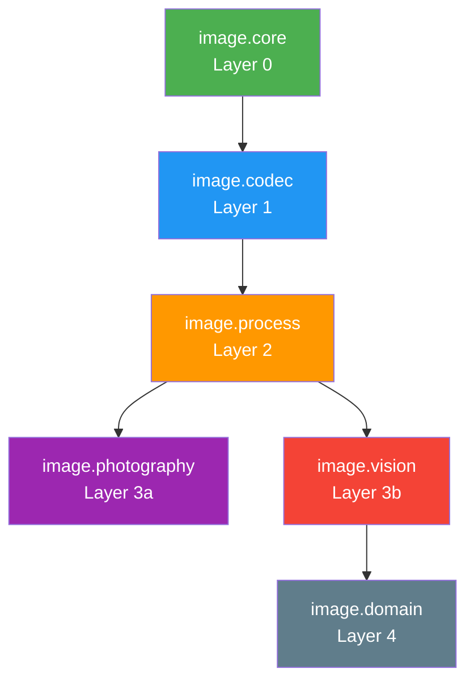

# image.mbt 架构文档

> 版本 0.1.15（S13 出口：16bit/float 覆盖收敛）| 3,888 公开函数 + 710 公开类型（.mbti 口径，78 包）| 6,836 测试 × 4 目标 (native/wasm-gc/js/wasm)

## 概述

walkzzz/image.mbt 是纯 MoonBit 图像处理库，无 C FFI 依赖，提供完整的图像解码/编码/缩放/处理能力。采用**多模块工作空间架构**，6 个子模块严格分层，用户直接 import 子模块包访问 API。

## 架构总览



## 模块详情

### image.core — Layer 0: 基础类型

| 包 | 功能 |
|----|------|
| types | Image, Image16, ImageF, LoadError, AnyImage, Pixel |

**依赖**: 无（零外部依赖）

### image.codec — Layer 1: 编解码

| 包 | 功能 |
|----|------|
| codec | 18 格式编解码 (PNG/JPEG/BMP/GIF/QOI/TGA/PSD/HDR/PNM/TIFF/ICO/CUR/ICNS/APNG/WebP/AVIF/HEIF/JPEG-XL) |
| lib | 高层封装 (自动格式分派 + 流式解码) |
| color | 色彩空间转换 (RGB/HSV/HSL/YCbCr/XYZ/Lab/CMYK) |
| meta | EXIF/XMP/IPTC/PNG text 元数据 |
| barcode | QR/条码检测与解码 |
| util | resize/zlib/配置工具 |

**依赖**: → core

### image.process — Layer 2: 图像处理算法

| 包 | 功能 |
|----|------|
| color | 色彩转换/调整/CLAHE/自适应阈值/Retinex/去雾 |
| edge | 边缘检测/Canny/霍夫/轮廓 |
| feature | 特征检测: Harris/ORB/SIFT/模板匹配/光流/GLCM/LBP |
| filter | 滤波/去噪/图像修复 |
| frequency | FFT/DCT/Haar 小波/频率滤波 |
| segment | 分水岭/SLIC/grabCut/形态学/连通域 |
| transform | 几何变换/透视/Seam Carving/金字塔 |
| enhance | 图像修复/去雾/降噪 |
| detection | 目标检测/跟踪 |
| stereo3d | 立体视觉 |

**依赖**: → core + codec

### image.photography — Layer 3a: 计算摄影

| 包 | 功能 |
|----|------|
| photo_enhance | 照片增强/HDR |
| superres | 超分辨率 |
| fusion | 图像融合 |
| stitch | 全景拼接 |
| style_transfer | 风格迁移/风格化 |
| inpainting | 图像修复 |
| computational_imaging | 计算成像 |
| neural_rendering | 神经渲染 |
| advanced_imaging | 高级成像 |
| compression | 图像压缩 |
| quality | 质量评估 |

**依赖**: → core + codec + process

### image.vision — Layer 3b: 计算机视觉

| 包 | 功能 |
|----|------|
| ocr | OCR 全链路 (19 个模块) |
| face_recognition | 人脸识别 |
| pose_estimation | 姿态估计 |
| slam | SLAM |
| video | 视频处理 |
| scene_understanding | 场景理解 |
| spatiotemporal | 时空分析 |
| vlm_multimodal | 视觉语言多模态 |
| intelligent_vision | 智能视觉 |
| fieldimg | 场图像 |
| imgir | 红外图像 |
| aoci | AOCI |

**依赖**: → core + codec + process

### image.domain — Layer 4: 领域应用

| 包 | 功能 |
|----|------|
| medical | 医学图像 |
| remote_sensing | 遥感 |
| encryption | 图像加密 |
| watermark | 水印 |
| forensics | 数字取证 |
| registration | 图像配准 |
| retrieval | 图像检索 |
| pipeline | 处理流水线 |
| performance | 性能优化 |
| production_utils | 生产工具 |
| texture | 纹理分析 |
| mesh | 网格处理 |
| point_cloud | 点云 |
| agent_kit | Agent 工具包 |
| self_evolve | 自进化 |
| util | 通用工具 |

**依赖**: → core + codec + process + vision

## 用户访问方式

**新模式**（当前，参考 pinyin 项目）：

```moonbit
import "walkzzz/image.core/types"
import "walkzzz/image.codec/lib"
import "walkzzz/image.process/filter"

let img : Image = @lib.load_from_bytes_auto(bytes)
let blurred : Image = @filter.gaussian_blur(img, 3.0)
```

## 工作空间配置

```json5
// moon.work
{
  "members": [".", "image.core", "image.codec", "image.process", "image.photography", "image.vision", "image.domain"]
}
```

```json5
// moon.mod (根模块)
{
  "name": "walkzzz/image.mbt",
  "version": "0.1.0"
}
```

```json5
// image.core/moon.mod
{
  "name": "walkzzz/image.core"
}
```

```json5
// image.codec/moon.mod
{
  "name": "walkzzz/image.codec",
  "import": { "walkzzz/image.core": "0.1.0" }
}
```

> **根模块附属包**：`mp4/`（ISO BMFF 容器解析，视频轨关键帧定位，属根模块 walkzzz/image.mbt 的直接子包，不在六子模块分层内）。

## 设计决策

| 决策 | 选择 | 原因 |
|------|------|------|
| 架构模式 | 多模块工作空间 | 115+ 包单模块根 moon.pkg 导入 65+ 包不可维护 |
| 子模块位置 | 根目录下直接放置 | 参考 pinyin 项目，结构直观 |
| reexport | 不做 reexport | 消除 20K 行 reexport.mbt 维护负担 |
| 目录前缀 | 0.1.0 起使用 image. 前缀（image.core/ 等，目录与 mooncakes 模块名 walkzzz/image.* 对应） | 重命名重构（0.6.x 时期曾不使用前缀，当时依赖 walkzzz/ 命名空间） |
| cv_advanced | 打散合并 | 72 文件单包违反 ≤30 文件原则 |
