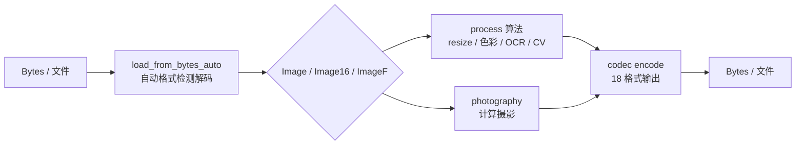

# 使用说明与提示

> 从 README 提取的详细提示、约束与版本说明。

## 版本与安装

> [!NOTE]
> mooncakes 包版本 `0.1.0` 对应**包重命名重构版**（walkzzz/image → walkzzz/image.mbt，六子模块 image.* 前缀，版本重新计数；旧名 walkzzz/image@0.6.0 已发布不再更新）；功能迭代版本（v0.1 → v237.0.0+）历史见 [changelog.md](changelog.md)。主模块安装：`moon add walkzzz/image.mbt`。

> [!TIP]
> **子模块可独立安装**（按需轻量依赖）：
> - `moon add walkzzz/image.core` — 基础类型（Image/Image16/ImageF/LoadError）
> - `moon add walkzzz/image.codec` — 18 种格式编解码 + 颜色 + 元数据 + 条码
> - `moon add walkzzz/image.process` — 90+ 图像算法子包
> - `moon add walkzzz/image.photography` / `walkzzz/image.vision` / `walkzzz/image.domain` — 上层能力

## 格式检测

> [!NOTE]
> `detect_format` 仅通过 magic bytes 识别 PNG/JPEG/BMP/GIF/QOI/PNM/PSD/HDR/WebP。TIFF/ICO/CUR/ICNS/APNG/TGA 需手动调用 `decode_tiff`/`decode_ico`/`decode_cur`/`decode_icns`/`decode_apng` 等函数。
> v244+ 已提供 `get_image_info_extended`（18 格式统一信息探测）与 `detect_image_format` 全格式检测，见 docs/roadmap.md。

## 多目标测试

> [!NOTE]
> 四目标（native / wasm-gc / js / wasm）均使用同一套纯 MoonBit 代码，各 **6585 测试**全部通过，覆盖率 77.7%（30267/38952，2026-11-20 实测），`moon check --deny-warn` 零警告。

> [!TIP]
> 四目标共用 workspace（image.core/image.codec/image.process/image.photography/image.vision/image.domain）同一套代码，无任何条件编译或目标分支。

## 安全约束

> [!WARNING]
> 所有解码器在分配内存前调用 `check_dims(width, height, channels)` 校验：
> - 宽/高必须为正数且不超过 `MAX_IMAGE_DIMENSION`（65535）
> - `width × height × channels` 不超过 `Int` 最大值（防整数溢出）
> - 校验失败时 `raise LoadError::DecodeFailed`
>
> `safe_mul` / `safe_mul3` 提供溢出安全乘法，返回 `Int?`（溢出时返回 `None`）。

## 主流程速查（任务流图）

## 三级像素深度决策表

| 类型 | 每像素 | 适用场景 | 注意 |
|---|---|---|---|
| `Image`（8-bit） | 1-4 字节 | 常规图像 / 显示 / 编码 / OCR-CV 输入 | 主力类型 |
| `Image16`（16-bit） | 2-8 字节 | 医学 / 遥感 / 高精度色彩 | 独家能力；内存 ×2 |
| `ImageF`（HDR float） | 12 字节（RGB float） | HDR / 光传输 / 合成 | 独家能力；**受 MAX_TOTAL_PIXELS=5e8 约束（峰值 ≈12 GB）** |

## 格式变体支持矩阵

| 格式 | 支持 | 不支持（明确报错） | 备注 |
|---|---|---|---|
| PNG | 8/16-bit、Adam7、APNG | — | 完整 |
| JPEG | 基线（sequential） | progressive（规划中） | — |
| TIFF | 无压缩 | LZW / PackBits（规划中） | `decode_tiff` 手动调用 |
| WebP | lossy 编码 + 解码 | lossless 自解码 | — |
| AVIF / HEIF / JPEG-XL | 基础解码 | 编码 | 边界见 README |
| PSD / ICNS / CUR | 解码 | — | — |

> [!NOTE]
> 不支持的变体会以 `LoadError::DecodeFailed` 明确报错（含原因），不会误解码——边界清晰承诺的深化。

## 形式化验证

> [!TIP]
> core/safe_math 通过 `moon prove` 验证 **8 个 goals**（溢出安全 / 维度有效 / clamp / 索引 / 旋转不变量等），另有 8 条谓词预留（SMT 超时与前端限制，清单见 safe_math.mbtp 注释）。

## 版本更新摘要

> [!TIP]
> **0.1.0（包重命名重构版）** — walkzzz/image → walkzzz/image.mbt · 六子模块统一 image.* 前缀（目录同步改名）· 版本重新计数 · API 零变化（.mbti 仅路径行变化）· README 双语迁移章节 · mp4 包修复完成（6585 测试 × 4 全绿）
>
> **0.6.0（workspace 重构）** — src/ 单体 → 六模块 workspace · 根 CHANGELOG · CI `--deny-warn` 零警告门禁 · badge 数据实测对齐（6574 测试 / 8 goals）· 子模块独立安装 · 自演化叙事（中英）
>
> 完整功能迭代历史见 [changelog.md](changelog.md)。
