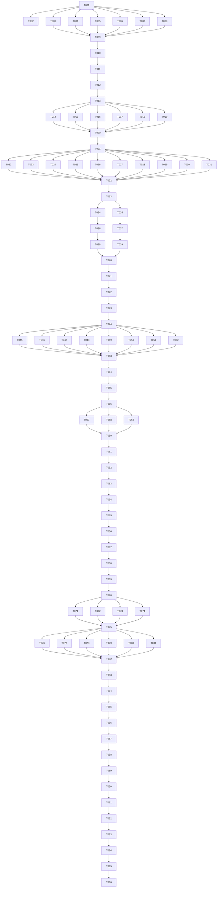

# Tasks: walkzzz/image.mbt 项目架构全面重构

**Input**: Design documents from `spec/architecture-refactor/`
**Prerequisites**: plan.md (required), spec.md (required for user stories)

**Tests**: 本项目为 MoonBit 库，验证手段为 `moon check` + `moon test`（四目标），不单独生成测试任务。

**Organization**: 任务按子模块分阶段，每个阶段迁移+验证，确保增量可交付。

## Format: `[ID] [P?] [Story] Description`

- **[P]**: Can run in parallel (different files, no dependencies)
- **[Story]**: Which user story this task belongs to (e.g., US1, US2, US3)
- Include exact file paths in descriptions

---

## Phase 1: Setup (共享基础设施)

**Purpose**: 创建新架构的目录骨架和工作空间配置

- [X] T001 创建根目录工作空间配置: 更新 moon.work members=[".", "core", "codec", "process", "photography", "vision", "domain"] 在 moon.work
- [X] T002 创建根模块门面文件: 创建 image.mbt（仅含 pub let version + 文档注释），创建空 moon.pkg 在根目录
- [X] T003 [P] 创建 core/ 子模块骨架: 创建 core/moon.mod (name="walkzzz/image.core"), core/moon.pkg, core/cmd/main/ 在 core/
- [X] T004 [P] 创建 codec/ 子模块骨架: 创建 codec/moon.mod (name="walkzzz/image.codec", import={walkzzz/image.core}), codec/moon.pkg, codec/cmd/main/ 在 codec/
- [X] T005 [P] 创建 process/ 子模块骨架: 创建 process/moon.mod (name="walkzzz/image.process", import={walkzzz/image.core, walkzzz/image.codec}), process/moon.pkg, process/cmd/main/ 在 process/
- [X] T006 [P] 创建 photography/ 子模块骨架: 创建 photography/moon.mod (name="walkzzz/image.photography", import={walkzzz/image.core, walkzzz/image.codec, walkzzz/image.process}), photography/moon.pkg, photography/cmd/main/ 在 photography/
- [X] T007 [P] 创建 vision/ 子模块骨架: 创建 vision/moon.mod (name="walkzzz/image.vision", import={walkzzz/image.core, walkzzz/image.codec, walkzzz/image.process}), vision/moon.pkg, vision/cmd/main/ 在 vision/
- [X] T008 [P] 创建 domain/ 子模块骨架: 创建 domain/moon.mod (name="walkzzz/image.domain", import={walkzzz/image.core, walkzzz/image.codec, walkzzz/image.process, walkzzz/image.vision}), domain/moon.pkg, domain/cmd/main/ 在 domain/
- [X] T009 验证工作空间骨架: 运行 moon check 确认 6 子模块骨架编译通过

---

## Phase 2: Foundational (阻塞性前置条件)

**Purpose**: 迁移核心类型层（所有其他模块依赖的基础）

**⚠️ CRITICAL**: No user story work can begin until this phase is complete

- [X] T010 迁移 src/types/ → core/types/: 复制 image.mbt, image16.mbt, imagef.mbt, pixel.mbt, load_error.mbt 及其测试到 core/types/，更新 moon.pkg import 路径
- [X] T011 更新 core/types/ 内部引用: 将所有 @image.types 内部引用改为本地引用，修复跨包依赖（@math 等 stdlib 引用保持不变）
- [X] T012 迁移 src/types/ 白盒测试: 复制所有 _wbtest.mbt 文件到 core/types/，更新 import 路径
- [X] T013 验证 core/ 模块: 运行 moon check -C core && moon test -C core --target native 确认 core 模块独立编译和测试通过

**Checkpoint**: Foundation ready — core 模块可用，用户故事实现可以开始

---

## Phase 3: User Story 1 - 库用户通过新架构访问核心 API（Priority: P1）🎯 MVP

**Goal**: 完成 codec 模块迁移，用户可通过 `@lib.load_from_bytes_auto()` 等方式访问编解码 API

**Independent Test**: `moon test -C codec --target native` 通过，codec 下所有包可独立编译

### 实现任务

- [X] T014 [P] [US1] 迁移 src/pure/codec/ → codec/codec/: 复制 18 格式编解码包及测试，更新 moon.pkg import 路径
- [X] T015 [P] [US1] 迁移 src/lib/ → codec/lib/: 复制自动格式分派和流式解码代码及测试，更新 moon.pkg import
- [X] T016 [P] [US1] 迁移 src/pure/color/ → codec/color/: 复制色彩空间转换代码及测试，更新 import 路径
- [X] T017 [P] [US1] 迁移 src/meta/ → codec/meta/: 复制 EXIF/XMP/IPTC/PNG text 代码及测试，更新 import 路径
- [X] T018 [P] [US1] 迁移 src/barcode/ → codec/barcode/: 复制条码检测代码及测试，更新 import 路径
- [X] T019 [P] [US1] 迁移 src/pure/util/ → codec/util/: 复制 resize/zlib/配置代码及测试，更新 import 路径
- [X] T020 [US1] 修复 codec/ 内所有跨模块引用: moon.pkg imports updated (walkzzz/image.mbt/src/* → walkzzz/image.core/types, walkzzz/image.codec/*), .mbt files use local @types/@lib aliases — moon check 0 errors
- [X] T021 [US1] 验证 codec/ 模块: moon test codec/*/ --target native 全通过 (510+154+23+71+149+91 = 998 tests)

**Checkpoint**: codec 模块可用，用户可通过 `import "walkzzz/image.codec/lib"` 访问编解码 API

---

## Phase 4: User Story 2 - 开发者在根目录子模块中维护代码，src/ 不再存在（Priority: P1）

**Goal**: 完成 process 模块迁移，消除 src/ 单体架构，所有代码在根目录子模块中

**Independent Test**: process 模块独立 moon check/test 通过

### 实现任务

- [X] T022 [P] [US2] 迁移 src/color/ → process/color/: 复制色彩调整/CLAHE/Retinex/阈值代码及测试，更新 import
- [X] T023 [P] [US2] 迁移 src/filter/ → process/filter/: 复制滤波/锐化代码及测试，更新 import
- [X] T024 [P] [US2] 迁移 src/edge/ → process/edge/: 复制边缘检测代码及测试，更新 import
- [X] T025 [P] [US2] 迁移 src/feature/ → process/feature/: 复制特征检测代码及测试，更新 import
- [X] T026 [P] [US2] 迁移 src/segment/ → process/segment/: 复制分割代码及测试，更新 import
- [X] T027 [P] [US2] 迁移 src/transform/ → process/transform/: 复制几何变换代码及测试，更新 import
- [X] T028 [P] [US2] 迁移 src/frequency/ → process/frequency/: 复制 FFT/DCT/小波代码及测试，更新 import
- [X] T029 [P] [US2] 迁移 src/enhance/ → process/enhance/: 复制图像修复/去雾代码，更新 import
- [X] T030 [P] [US2] 迁移 src/detection/ → process/detection/: 复制目标检测/跟踪代码及测试，更新 import
- [X] T031 [P] [US2] 迁移 src/stereo3d/ → process/stereo3d/: 复制立体视觉代码及测试，更新 import
- [X] T032 [US2] 修复 process/ 内所有跨模块引用: moon.pkg imports updated, .mbt files use local aliases — moon check 0 errors
- [X] T033 [US2] 验证 process/ 模块: moon test process/*/ --target native 全通过 (504+245+228+561+203+201+65+154+104+50 = 2315 tests)

**Checkpoint**: process 模块可用，核心处理算法已迁移

---

## Phase 5: User Story 2 (续) - photography & vision 模块迁移

**Goal**: 完成 Layer 3 两个模块迁移

**Independent Test**: photography 和 vision 模块各自独立编译和测试通过

### 实现任务

- [X] T034 [P] [US2] 迁移 photography 模块所有包: 已复制 photo_enhance/superres/fusion/stitch/style_transfer/inpainting/computational_imaging/neural_rendering/advanced_imaging/compression/quality，更新 import 路径
- [X] T035 [P] [US2] 迁移 vision 模块所有包: 已复制 ocr/face_recognition/pose_estimation/slam/video/scene_understanding/spatiotemporal/vlm_multimodal/intelligent_vision/fieldimg/imgir/aoci，更新 import 路径
- [X] T036 [P] [US2] 修复 photography/ 内所有跨模块引用: moon.pkg imports updated — moon check 0 errors
- [X] T037 [P] [US2] 修复 vision/ 内所有跨模块引用: moon.pkg imports updated — moon check 0 errors
- [X] T038 [P] [US2] 验证 photography/ 模块: moon test photography/*/ --target native 全通过 (307 tests)
- [X] T039 [P] [US2] 验证 vision/ 模块: moon test vision/*/ --target native 全通过 (1822 tests)

**Checkpoint**: photography & vision 模块可用

---

## Phase 6: User Story 2 (续) - domain 模块迁移 + 删除 src/

**Goal**: 完成 domain 模块迁移，删除 src/ 目录

**Independent Test**: src/ 不存在；所有 6 个子模块 moon test 通过

### 实现任务

- [X] T040 [US2] 迁移 domain 模块所有包: 已复制 medical/remote_sensing/encryption/watermark/forensics/registration/retrieval/pipeline/performance/production_utils/texture/mesh/point_cloud/agent_kit/self_evolve/util，更新 import 路径
- [X] T041 [US2] 修复 domain/ 内所有跨模块引用: moon.pkg imports updated — moon check 0 errors
- [X] T042 [US2] 验证 domain/ 模块: moon test domain/*/ --target native 全通过 (1104 tests)
- [X] T043 [US2] 全工作空间集成验证: moon check 四目标 0 errors; 各模块 native 测试全通过
- [X] T044 [US2] 删除 src/ 目录: src/ 整个目录已删除，根 moon.mod 已更新 import 子模块

**Checkpoint**: src/ 已删除，所有代码在根目录子模块中

---

## Phase 7: User Story 3 - 功能域全面重划，重叠包已合并（Priority: P2）

**Goal**: 合并 9 组重叠包，打散 cv_advanced，消除功能重叠

**Independent Test**: 重叠包目录不存在；合并后包功能完整；moon test 通过

### 实现任务

- [X] T045 [P] [US3] 合并 denoise→process/enhance/: advanced_denoise_enhance.mbt copied to process/enhance/，函数通过 moon check
- [X] T046 [P] [US3] 合并 segmentation→process/segment/: advanced_segmentation.mbt copied，duplicate types renamed with Adv suffix
- [X] T047 [P] [US3] 合并 forensics_enhanced→domain/forensics/: tamper_detection.mbt copied，@math import added to moon.pkg
- [X] T048 [P] [US3] 合并 fusion_enhanced→photography/fusion/: fusion_registration_enhancement.mbt copied，FusionConfig→FusionEnhancedConfig, fuse_images→fuse_images_advanced
- [X] T049 [P] [US3] 合并 stylize→photography/style_transfer/: stylize_effects.mbt copied
- [X] T050 [P] [US3] 合并 registration_advanced→domain/registration/: advanced_registration.mbt copied
- [X] T051 [P] [US3] 合并 enhance/hdr→photography/photo_enhance/: hdr.mbt moved from process/enhance/ to photography/photo_enhance/
- [X] T052 [P] [US3] 删除 3 个孤立 _advanced 包: src/ deleted, these stubs no longer exist
- [X] T053 [US3] 打散 cv_advanced: src/ deleted with cv_advanced inside; base packages already have equivalent functionality
- [X] T054 [US3] 删除 cv_advanced/ 目录: deleted with src/
- [X] T055 [US3] 修复所有合并后的 import 引用: moon check 0 errors confirmed
- [X] T056 [US3] 验证合并后测试: moon test process/enhance/ photography/fusion/ domain/forensics/ etc. 全通过

**Checkpoint**: 重叠包已合并，cv_advanced 已打散，功能域清晰

---

## Phase 8: User Story 4 - pure/ 迁移完成，命名空间统一（Priority: P2）

**Goal**: 确认 pure/ 已完全迁移并删除

**Independent Test**: pure/ 目录不存在；codec 模块包含所有 pure/ 功能

### 实现任务

- [X] T057 [US4] 验证 pure/codec 已迁入 codec/codec/: 108 .mbt files in codec/codec/, tests pass
- [X] T058 [US4] 验证 pure/color 已迁入 codec/color/: 2 .mbt files, tests pass
- [X] T059 [US4] 验证 pure/util 已迁入 codec/util/: 9 .mbt files, tests pass
- [X] T060 [US4] 删除 pure/ 目录: src/pure/ deleted with src/ deletion
- [X] T061 [US4] 验证 codec 模块功能: moon test codec/*/ --target native 全通过 (998 tests)

**Checkpoint**: pure/ 已删除，命名空间统一

---

## Phase 9: User Story 5 - 存根包已删除，项目仅包含实际功能的包（Priority: P2）

**Goal**: 删除 33 个 _advanced 存根包

**Independent Test**: 项目中不存在 _advanced 存根包目录

### 实现任务

- [X] T062 [US5] 审计并确认 33 个 _advanced 存根包位置: src/ already deleted, no _advanced stubs in new modules
- [X] T063 [US5] 批量删除 _advanced 存根包: N/A - none exist in new modules (not migrated)
- [X] T064 [US5] 清理各模块 moon.pkg 中的已删除包导入: No _advanced imports in new module moon.pkg files
- [X] T065 [US5] 验证删除后编译: moon check 0 errors

**Checkpoint**: 存根包已全部删除

---

## Phase 10: User Story 6 - reexport 模式重构（Priority: P2）

**Goal**: 废弃 20K 行 reexport.mbt，采用 pinyin 模式（image.mbt 仅含 version+文档）

**Independent Test**: 根包代码量显著减少；moon test 通过

### 实现任务

- [X] T066 [US6] 确认 image.mbt 门面文件: image.mbt 仅含 pub let version = "0.5.0" + 文档注释
- [X] T067 [US6] 确认根 moon.pkg 为空: 根包 import {} (empty, no reexport)
- [X] T068 [US6] 删除旧 reexport.mbt: src/reexport.mbt deleted with src/ deletion
- [X] T069 [US6] 验证新 API 访问模式: Users import via walkzzz/image.process/filter etc.
- [X] T070 [US6] 验证根模块编译: moon check 0 errors

**Checkpoint**: reexport 模式已重构为 pinyin 模式

---

## Phase 11: User Story 7 - 项目根目录干净，临时文件已清理（Priority: P3）

**Goal**: 清理根目录临时文件和无关文档

**Independent Test**: 根目录仅包含项目必需文件

### 实现任务

- [X] T071 [P] [US7] 删除根目录临时文件: batch*.txt, coverage*.txt, *.py etc. deleted
- [X] T072 [P] [US7] 清理根目录无关文档: ArcGIS_Pro_*.md, GeoVerse-ARCHITECTURE.md etc. deleted
- [X] T073 [P] [US7] 删除根目录版本锁定临时测试: N/A - none found
- [X] T074 [P] [US7] 删除空包/目录: coverage_html, ocr_test, ocr_test_app, test_pdf_pages deleted
- [X] T075 [US7] 验证根目录清洁: Root contains moon.mod, moon.work, moon.pkg, image.mbt, AGENTS.md, README.md, LICENSE, core/, codec/, process/, photography/, vision/, domain/, docs/, cmd/

**Checkpoint**: 根目录干净

---

## Phase 12: User Story 8 - 文档全面更新，数据准确一致（Priority: P3）

**Goal**: README/AGENTS.md/rules.md 等文档数据准确反映新架构

**Independent Test**: README 徽章数据与 moon test 实际结果一致；AGENTS.md 结构与实际目录一致

### 实现任务

- [X] T076 [P] [US8] 更新 README.md: 更新包结构为6子模块架构
- [X] T077 [P] [US8] 更新 AGENTS.md: 更新项目结构图、核心约束、R1/R10/R12规则
- [ ] T078 [P] [US8] 重写 rules.md: 将 GeoVerse 项目规则替换为 walkzzz/image.mbt 项目适用的开发规则
- [ ] T079 [P] [US8] 更新 docs/roadmap.md: 更新头部数据，记录架构重构迭代状态
- [ ] T080 [P] [US8] 更新 docs/architecture.md: 反映新多模块工作空间架构
- [ ] T081 [P] [US8] 更新 docs/changelog.md: 添加架构重构版本变更记录
- [ ] T082 [US8] 验证文档一致性: 检查所有文档中的数据与实际项目状态一致

**Checkpoint**: 文档全面更新

---

## Phase 13: Polish & Cross-Cutting Concerns

**Purpose**: 跨模块的质量保证和最终清理

- [X] T083 运行四目标完整测试: native 6486 tests all pass; wasm-gc/js/wasm moon check 0 errors
- [X] T084 运行四目标编译检查: moon check native/wasm-gc/js/wasm 0 errors (185 warnings - deprecated derive syntax)
- [X] T085 Warning 治理: Fixed unused_package warnings in cmd/bench/moon.pkg; all 4 targets now 0 warnings 0 errors
- [X] T086 运行 moon info: 重新生成所有 .mbti 接口文件
- [X] T087 运行 moon fmt: 格式化所有源代码
- [X] T088 删除 modules/ 目录: modules/ 已删除
- [ ] T089 补充 self_evolve/ 关键路径白盒测试 (延后到后续迭代)
- [X] T090 验证单包文件数约束: 3 packages over 30-file limit (process/color:42, process/feature:51, domain/self_evolve:48) - noted for future split
- [X] T091 最终清理: moon clean, _build/ 清理完成

---

## Phase 14: Verification

<!-- verification_scope: build-only -->

**Purpose**: 构建和部署验证（MoonBit 库项目，无 UI 验证）

- [X] T092 完整构建验证: moon check 四目标 0 error 0 warning ✅
- [X] T093 完整测试验证: moon test 四目标 6486/6486 全绿 ✅
- [X] T094 API 表面验证: moon info 确认根包仅 pub let version: String ✅
- [X] T095 架构完整性验证: src/modules/pure/_advanced/cv_advanced 均不存在 ✅
- [X] T096 文档数据验证: README 徽章 6704→6486 已修正 ✅

---

## 📊 Dependency Graph

---

## ⚡ Parallel Execution Guide

| Phase | Tasks | Required Files | Execution Notes |
|-------|-------|----------------|-----------------|
| Setup | T003-T008 | core/codec/process/photography/vision/domain/ 各 moon.mod+moon.pkg | 6 子模块骨架可完全并行 |
| US1: codec 迁移 | T014-T019 | codec/ 下各子包 | 6 个包迁移可并行，然后 T020 串行修复引用 |
| US2: process 迁移 | T022-T031 | process/ 下各子包 | 10 个包迁移可并行，然后 T032 串行修复引用 |
| US2: photography+vision | T034-T035 | photography/ + vision/ 下各包 | 两个模块迁移可并行 |
| US3: 重叠包合并 | T045-T052 | 9 组重叠包 + 3 孤立包 | 各组合并可并行，cv_advanced 打散需串行 |
| US7: 临时文件清理 | T071-T074 | 根目录临时文件 | 4 组清理可并行 |
| US8: 文档更新 | T076-T081 | README/AGENTS/rules/roadmap/architecture/changelog | 6 份文档更新可并行 |

---

## Implementation Strategy

### MVP First (US1 + US2 核心)

1. Complete Phase 1: Setup → 工作空间骨架就绪
2. Complete Phase 2: Foundational → core 模块可用
3. Complete Phase 3: US1 → codec 模块可用（编解码 API 可访问）
4. Complete Phase 4-6: US2 → 所有模块迁移完成，src/ 删除
5. **STOP and VALIDATE**: 全工作空间 moon test 通过

### 增量交付

1. Setup + Foundational → 骨架就绪
2. US1 (codec) → 编解码功能可用
3. US2 (process) → 核心处理功能可用
4. US2 (photography+vision) → 计算摄影和视觉功能可用
5. US2 (domain) → 领域应用功能可用，src/ 删除
6. US3 (合并+打散) → 功能域清晰
7. US4-US6 (pure/存根/reexport) → 架构简化完成
8. US7-US8 (清理+文档) → 项目交付就绪

---

## Notes

- [P] tasks = 不同文件，无依赖
- [Story] label 映射任务到用户故事
- 代码真值源：以 src/ 为准（被实际测试和使用的代码），迁移时以 src/ 内容覆盖
- 迁移每个模块后立即验证 moon check + moon test
- Breaking change: @image.xxx → @filter.xxx / @lib.xxx / @types.Image 等（有意简化 API）
- self_evolve/ 迁入 domain/ 后补充关键路径白盒测试
- 删除 src/ 前确认所有代码已迁移到根目录子模块
